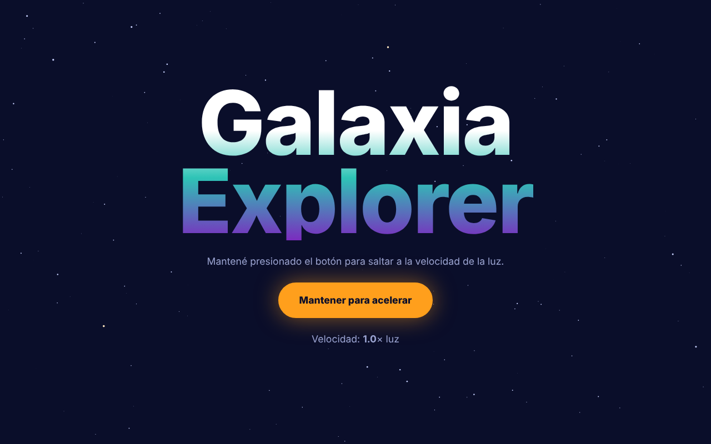
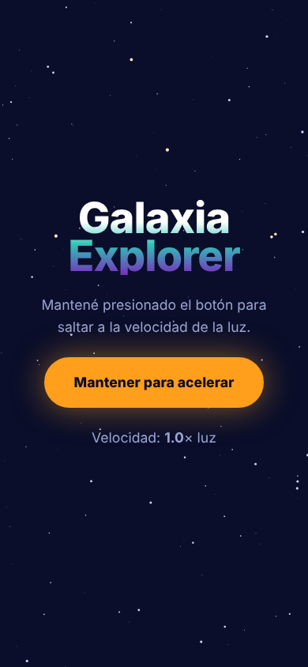

# Galaxia Explorer

  

Viaje interactivo por el sistema solar: campo de estrellas 3D con salto a la velocidad de la luz, ficha de cada planeta y calculadora de peso según la gravedad.

**🔗 Demo en vivo:** https://rumenco1221.github.io/galaxia-explorer/



## ✨ Funcionalidades

- Campo de estrellas en perspectiva dibujado en canvas
- Botón que se mantiene presionado para acelerar (pointer events)
- Selector de planetas con ficha de datos
- Calculadora de peso con un slider

## 🛠️ Tecnologías

- HTML5 semántico
- CSS3 (variables, Flexbox, Grid, animaciones, diseño responsive)
- JavaScript moderno (ES6+), sin frameworks ni librerías
- Fuentes de Google Fonts: Exo 2

## 🧠 Lo que practiqué

- Proyección en perspectiva simple (x/z)
- Interpolación suave de velocidad
- Eventos `pointerdown`/`pointerup` y de teclado
- Gradientes CSS para dibujar planetas
- `prefers-reduced-motion`

## 🎨 Diseño

- **Paleta:** Espacio `#0A0E2A`, nebulosa `#7B2CBF`, aurora `#2EC4B6`, sol `#FF9F1C`
- **Tipografía:** Exo 2
- Responsive desde 360 px, foco visible con teclado y respeto por `prefers-reduced-motion`.



## 📁 Estructura

```
galaxia-explorer/
├── index.html
├── assets/
│   ├── css/styles.css
│   └── js/main.js
├── docs/DOCUMENTACION.md
├── images/              # capturas
├── tests/               # pruebas automáticas
└── version_history/CHANGELOG.md
```

## ▶️ Cómo verlo

1. Descargá o cloná el repositorio: `git clone https://github.com/Rumenco1221/galaxia-explorer.git`
2. Abrí `index.html` con doble clic, o usá la extensión **Live Server** de VS Code.

## ✅ Pruebas

Con Node.js instalado, desde la carpeta del proyecto:

```bash
node --test tests/test_estructura.mjs
```

Verifica SEO básico, semántica, accesibilidad de imágenes y que existan los archivos CSS y JS.

## 🚀 Próximas mejoras

- [ ] Órbitas animadas alrededor del Sol
- [ ] Datos desde la API de la NASA
- [ ] Modo quiz: adiviná el planeta

## 👩‍💻 Autora

**Estela Oviedo Cortez** — Desarrolladora Full Stack en formación.
[LinkedIn](https://www.linkedin.com/in/estela-oviedo-cortez-796303228) · [GitHub](https://github.com/Rumenco1221)

## 📄 Licencia

MIT. Ver [LICENSE](LICENSE).
